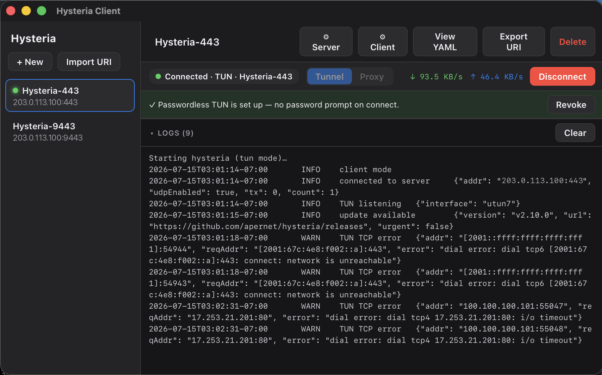

# Hysteria Client UI

A desktop GUI client for the [Hysteria2](https://v2.hysteria.network/) proxy, built with
[Tauri](https://tauri.app/) (Rust core + React/TypeScript UI).



It lets you:

- **Create and edit** Hysteria2 client configurations through a structured form (with a raw-YAML
  escape hatch for advanced options).
- **Import and export** configs as `hysteria2://` / `hy2://` share URIs.
- **Manage multiple server profiles** and switch between them.
- **Run the connection** itself — start/stop the bundled `hysteria` binary, watch live logs, and
  expose a local SOCKS5/HTTP proxy or a system-wide **TUN** tunnel.

Runs on macOS today; the proxy path is cross-platform (Windows/Linux) with little change. TUN mode
is macOS-only for now.

## Architecture

```
src/                     React + TypeScript frontend (Vite)
  types.ts               shared model types (mirrors the Rust model)
  lib/api.ts             thin wrappers over the Tauri command IPC
  components/            Sidebar, ConfigForm, ConnectionBar, LogView, fields
  App.tsx                orchestration + event subscriptions

src-tauri/src/           Rust core
  model.rs               Profile / HysteriaConfig structs (serde, camelCase over IPC)
  uri.rs                 parse_uri() / build_uri()  — source of truth for URI <-> model
  config.rs              generate_yaml()            — model -> Hysteria2 client YAML
  store.rs               profile persistence (profiles.json in the app config dir)
  runner.rs              spawn/stop hysteria, stream logs, track status; TUN elevation
  lib.rs                 Tauri commands, state, system tray
src-tauri/binaries/hysteria   the hysteria client binary (bundled as a resource)
```

The Rust side is the source of truth: URI parsing and YAML generation live in `uri.rs` / `config.rs`
and are exercised by unit tests (including a round-trip of the reference example URI). The frontend
never re-implements that logic — it calls the commands.

## Prerequisites

- [Node.js](https://nodejs.org/) 18+
- [Rust](https://rustup.rs/) (stable)
- The `hysteria` binary at `src-tauri/binaries/hysteria`. Download the client for your platform
  from the [releases page](https://github.com/apernet/hysteria/releases) (the app is tested against
  v2.13.0):

  ```sh
  # macOS Apple Silicon example
  curl -fL -o src-tauri/binaries/hysteria \
    https://github.com/apernet/hysteria/releases/download/app/v2.13.0/hysteria-darwin-arm64
  chmod +x src-tauri/binaries/hysteria
  ```

## Develop

```sh
npm install
npm run tauri dev
```

## Build

```sh
npm run tauri build      # produces a .app and .dmg under src-tauri/target/release/bundle/
```

## Testing

```sh
cd src-tauri && cargo test     # URI parse/build + YAML generation unit tests
```

## Connection modes

- **Proxy** (default, no privileges): runs `hysteria client -c <config>` as a normal child process
  and exposes the SOCKS5/HTTP listeners you configured. Use it with, e.g.,
  `curl --socks5 127.0.0.1:1080 https://ifconfig.me`.
- **TUN** (system-wide, requires admin): traffic from *every* app on the machine is routed through
  the tunnel, with no per-app proxy configuration. This needs root — see below.

## Why TUN mode needs root

Proxy mode never asks for privileges: it just opens a listening socket on a high port in your own
user account, and it's up to each app to opt in by pointing at `127.0.0.1:1080`.

TUN mode is system-wide instead of opt-in, and both halves of that require root:

1. **Creating the virtual network interface.** The tunnel is a `utun` device — a kernel network
   interface that hands packets to a userspace process. On macOS, opening the `utun` kernel control
   socket is a privileged operation, so the process that creates the interface must be root.
2. **Changing the system routing table.** An interface that receives no packets is useless, so
   hysteria installs routes that send the machine's traffic into the tunnel. Editing the kernel
   routing table is likewise root-only.

So the privilege isn't for the GUI, or for reading your files, or for anything persistent — it is
what the macOS kernel demands from any process that wants to create a network interface and route
the system's traffic into it. Every VPN client on macOS pays this cost in some form.

**What actually runs as root.** Only the bundled `hysteria` binary. The Tauri app itself always runs
as you; it shells out to launch the client elevated and talks to it over pipes. Two implementation
details follow from doing this on macOS: the interface name must be `utun<N>` (the app assigns the
lowest free index automatically), and the server's own IP is added to `excludeRoutes` at connect
time — otherwise the tunnel would capture the proxy's own connection to the server and deadlock.

### Getting the password prompt out of the way

By default the client is launched via `osascript ... with administrator privileges`, which prompts
for your password on **every** connect *and* disconnect (stopping a root process also needs root).

**Grant privileges once:** in TUN mode the app shows a **"Set up passwordless access"** button. It
installs a rule under `/etc/sudoers.d/hysteria-ui` (one admin prompt, validated with `visudo` before
and after install) that lets *only* these two exact commands run as root without a password:

```
<you> ALL=(root) NOPASSWD: <app>/binaries/hysteria client -c <app-cache>/active-config.yaml
<you> ALL=(root) NOPASSWD: /usr/bin/pkill -f <app-cache>/active-config.yaml
```

That is, the bundled binary with *that* config path, and the `pkill` that stops it. It is not a
blanket `NOPASSWD: ALL`, and it grants nothing to any other binary. After that, connect/disconnect
never prompt. Click **Revoke** to remove the rule (`rm /etc/sudoers.d/hysteria-ui`).

Two caveats worth knowing before you install it:

- The rule is **pinned to the current binary path**, so if you move or reinstall the app, the rule
  stops matching and you re-run the setup.
- The config path it names is writable by your user, so anything that can write that file can
  influence what the elevated hysteria process is configured to do. That's the trade you're making
  for skipping the prompt; if you'd rather not, just leave the rule uninstalled and keep typing your
  password.

> A fully prompt-free, signed `launchd` privileged helper (via `SMAppService`) is the alternative
> production approach; it requires Developer ID signing + notarization.

## Releasing

Releases are built by `.github/workflows/release.yml` when you push a `v*` tag:

```sh
git tag v0.2.0
git push origin v0.2.0
```

The workflow derives the version from the tag (patching `package.json`, `tauri.conf.json` and
`Cargo.toml`, so you don't have to bump them by hand), downloads the matching `hysteria` binary
for each architecture, runs `cargo test`, and builds a `.dmg` for both Apple Silicon
(`aarch64-apple-darwin`) and Intel (`x86_64-apple-darwin`).

The result is a **draft** release — review the generated notes and publish it from the GitHub
Releases page. The bundled hysteria version is pinned by `HYSTERIA_RELEASE` in the workflow
(currently `app/v2.13.0`); set it to `latest` to track upstream instead.

The builds are **unsigned**: users will get a Gatekeeper warning on first launch. To sign and
notarize, add the `APPLE_CERTIFICATE`, `APPLE_CERTIFICATE_PASSWORD`, `APPLE_SIGNING_IDENTITY`,
`APPLE_ID`, `APPLE_PASSWORD` and `APPLE_TEAM_ID` secrets and pass them through to the
`tauri-action` step ([docs](https://tauri.app/distribute/sign/macos/)).

## URI format

```
hysteria2://[auth@]host[:port]/?obfs=&obfs-password=&sni=&insecure=&pinSHA256=#name
```

Per the Hysteria2 spec the URI carries only connection essentials. Local settings (proxy listeners,
bandwidth, TUN, fastOpen, ...) are app-managed and are **not** part of the URI.
